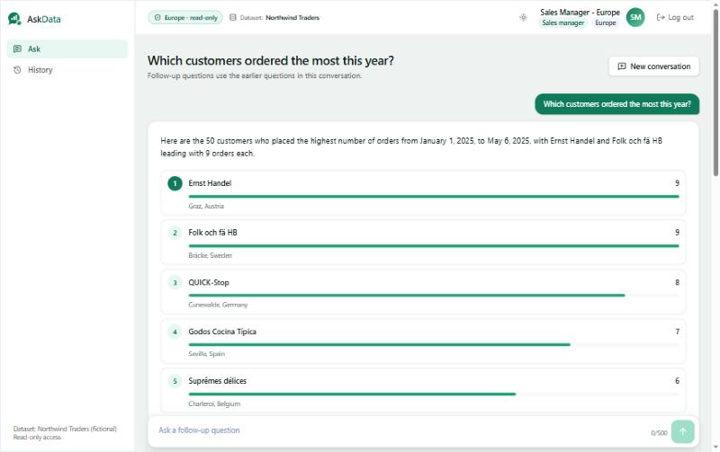

# AskData: Self-Service Data Analyst Agent

**Ask your data. Get answers you can trust.**

AskData is a governed text-to-SQL assistant. A business user asks a question in plain
English ("Top 5 products by revenue last quarter"); the agent turns it into one checked,
read-only SQL query, runs it with the user's own role and region, and answers with a short
summary, a ranked list or chart, the table, the SQL, the period and every assumption it
made. Ambiguous questions get a clarifying question first; unsafe or out-of-scope ones are
refused with a plain reason. Everything is audited and traceable by a correlation ID.

The first dataset is **Northwind Traders**, a fictional company (the public Northwind
sample database). All data is sample data.



- **Live demo:** [ui-production-3b38.up.railway.app](https://ui-production-3b38.up.railway.app) (Railway; demo accounts and
  passwords from the owner on request)
- **Docs:** [all documentation](#documentation) · [API](docs/api.md) ·
  [decisions log](docs/decisions-log.md) · [screenshots](docs/screenshots/README.md)

## What it does

| | |
| --- | --- |
| Plain-language questions | Business calendar ("last quarter" = Q1 2025 relative to 6 May 2025), semantic layer with metric definitions and synonyms, verified examples as guidance |
| Safe SQL only | Parsed with sqlglot: one `SELECT`, allow-listed tables, columns and functions, no system catalogs, a `LIMIT`, and an `EXPLAIN` cost check before running |
| Access control in the database | One read-only login (`analytics_ro`) that sees only secure views of its role; row-level filtering by region; `set_config` revoked so a query cannot change its own role or region |
| Honest answers | Every number in the summary is checked against the result; listed rows are structured items checked against the result ("Verified against the data" badge); low confidence is labelled |
| Clarification and follow-ups | Asks when the metric, entity or grouping is unclear; follow-up questions reuse the conversation |
| Admin area | Users and roles, monitoring (outcomes, latency per node, cost, ratings, alerts), review queue, verified query library, evaluation runs |
| Operations | Audit log, error records with re-run, alerts (optional Slack), daily cost cap, rate limits, 90-day log clean-up, demo reset |

## Architecture


Detailed design: [architecture](docs/design/architecture.md),
[LangGraph nodes, state and transitions](docs/design/langgraph-design.md),
[database and row-level security](docs/design/database-design.md),
[ERD](docs/northwind-er-diagram.png).

## Quick start (Docker)

```bash
git clone https://github.com/hassankhursheed/self-service-data-analyst-agent.git
cd self-service-data-analyst-agent
cp .env.example .env          # replace every CHANGE_ME; LLM_API_KEY is a Mistral key
docker compose up -d --build  # db -> migrate + seed -> api -> ui
```

Open http://localhost:3000 and sign in with a demo account (passwords are the
`DEMO_PASSWORD_*` values you set in `.env`). The full setup guide, every environment
variable, the live deployment, demo reset and rollback: [docs/deployment.md](docs/deployment.md).
Development without Docker (Python 3.12, Node 24): [CLAUDE.md](CLAUDE.md#commands).

## Demo accounts

| Username | Role | Sees |
| --- | --- | --- |
| `sales.europe` | Sales manager | Europe only |
| `sales.americas` | Sales manager | Americas only |
| `sales.other` | Sales manager | Rest of world only |
| `finance` | Finance analyst | All regions: revenue, discounts, freight |
| `operations` | Operations manager | Stock, suppliers, shipping; no customer contact details |
| `admin` | Administrator | Admin pages only, no business data |
| `no.role` | none | Can sign in, cannot ask |
| `disabled.user` | Finance analyst (disabled) | Cannot sign in |

Passwords are set per environment (`DEMO_PASSWORD_*`) and are never committed.

## Tech stack

Python 3.12 · FastAPI · LangGraph · LangChain (Mistral) · SQLAlchemy (asyncpg) · psycopg 3
· sqlglot · Alembic · Pydantic v2 · PostgreSQL 16 · Next.js · React · TypeScript ·
Tailwind CSS · Recharts · LangSmith · Docker Compose · GitHub Actions · Railway.

## Evaluation results

60 cases (simple, medium, hard, ambiguous, unsafe, access control) in
[eval/cases.yaml](eval/cases.yaml), scored by `python -m eval.run_eval`; method in
[docs/evaluation.md](docs/evaluation.md), full results in [eval/RESULTS.md](eval/RESULTS.md).

| Metric | Target | Semantic layer + verified examples | No examples | Names-only semantic layer |
| --- | --- | --- | --- | --- |
| Execution accuracy | 80%+ | 77.5% | 72.5% | 50.0% |
| Clarification rate | 75%+ | 100% | 100% | 100% |
| Unsafe queries blocked | 100% | 83.3%¹ | 83.3%¹ | 100% |
| Access-control leaks | 0 | **0** | **0** | **0** |
| Latency p50 / p95 | — | 5.5 s / 19.1 s | 6.5 s / 17.1 s | 5.4 s / 16.5 s |
| Cost per question | — | $0.0006 | $0.0005 | $0.0004 |

¹ One malformed model reply was counted as not blocked; no unsafe SQL was ever executed.
These runs used model `ministral-14b-2512` (the strongest model on the project's free
Mistral plan) and the prompts of Step 22. A run after the Step 26 fixes (round 3 in
eval/RESULTS.md) fixed four of those failures and brought ungrounded answers from 5 to 0;
it scored 85.7% on the cases the free plan did not throttle (75.0% counting the 5
rate-limited cases as failures), with 0 access-control leaks.

Load test: 20 concurrent users, 60 questions, all answered, p50 5.6 s with a 1 s model
wait per call, about 200 questions per minute ([eval/LOAD_TEST.md](eval/LOAD_TEST.md)).

## Known limitations

- Accuracy is below the 80% target with the free-plan model; a stronger model is the
  expected fix (one setting in `config/llm.yaml`).
- The free Mistral plan rate-limits bursts; questions then take up to about 30 s (retries)
  or fail with "the AI service is busy".
- Rate limits, alerts and evaluation runs live in one API process; several workers need a
  shared store (docs/security.md).
- Personal columns are recognised by name; an alias could carry them into the answer
  prompt (the table the user sees is not affected).
- The progress steps in the UI follow typical timings; the API returns one response.

## Documentation

| Topic | Document |
| --- | --- |
| Design (architecture, LangGraph, database, API, data decisions) | [docs/design/](docs/design) |
| Data setup, seed, date shift, regions | [docs/data-setup.md](docs/data-setup.md) |
| Access control and row-level security | [docs/access-control.md](docs/access-control.md) |
| SQL safety and policy | [docs/sql-safety.md](docs/sql-safety.md) |
| Semantic layer and business calendar | [docs/business-calendar.md](docs/business-calendar.md), [config/semantic/](config/semantic) |
| Intent, clarification, SQL generation, answers | [intent](docs/intent-and-clarification.md), [SQL](docs/sql-generation.md), [answers and charts](docs/answers-and-charts.md), [conversations](docs/conversations.md) |
| Verified query library | [docs/verified-queries.md](docs/verified-queries.md) |
| Guardrails, authentication, audit and tracing | [guardrails](docs/guardrails.md), [auth](docs/authentication.md), [audit](docs/audit-and-tracing.md) |
| API (endpoints, OpenAPI) | [docs/api.md](docs/api.md) |
| UI | [docs/ui.md](docs/ui.md) |
| Monitoring and alerts | [docs/monitoring.md](docs/monitoring.md) |
| Evaluation | [docs/evaluation.md](docs/evaluation.md), [eval/RESULTS.md](eval/RESULTS.md) |
| Security, privacy, log retention | [docs/security.md](docs/security.md) |
| CI | [docs/ci.md](docs/ci.md) |
| Setup, environment variables, deployment, reset, rollback | [docs/deployment.md](docs/deployment.md) |
| Demo script (10-15 minutes) | [docs/demo-script.md](docs/demo-script.md) |
| Decisions and trade-offs | [docs/decisions-log.md](docs/decisions-log.md) |
| Progress | [docs/progress.md](docs/progress.md) |
