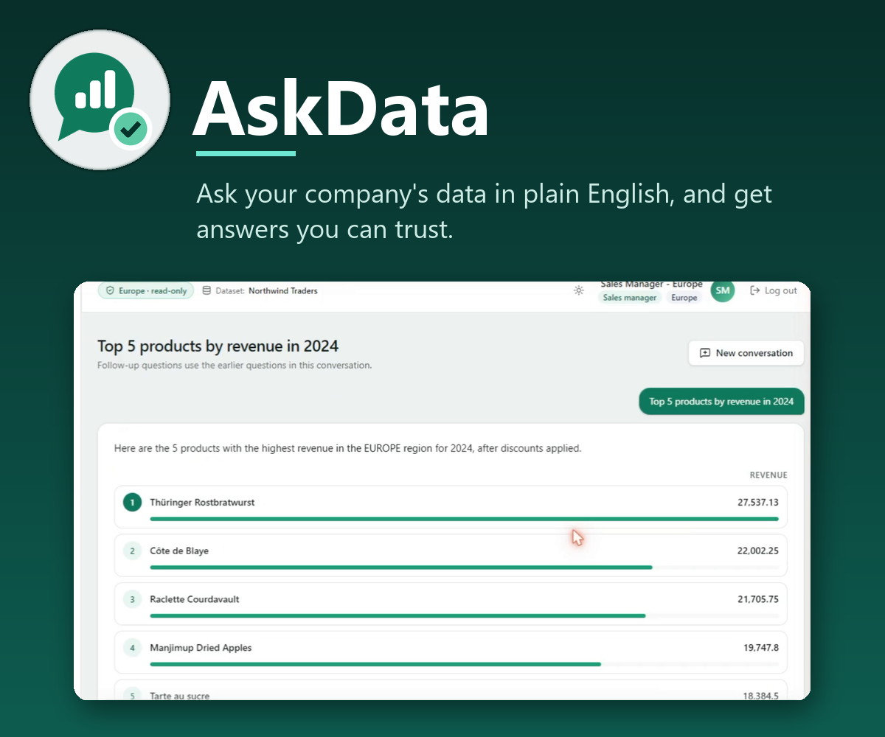
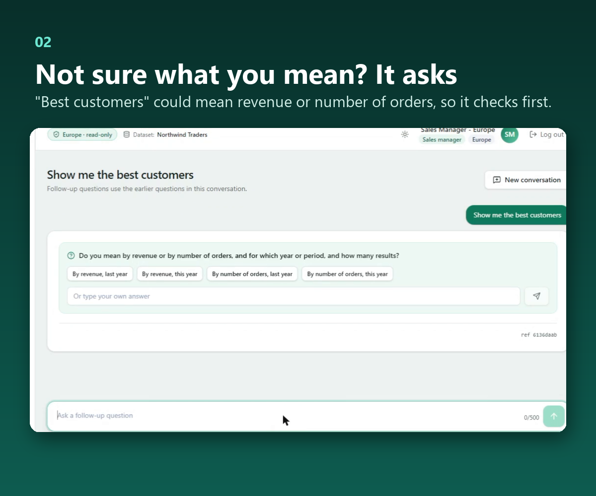
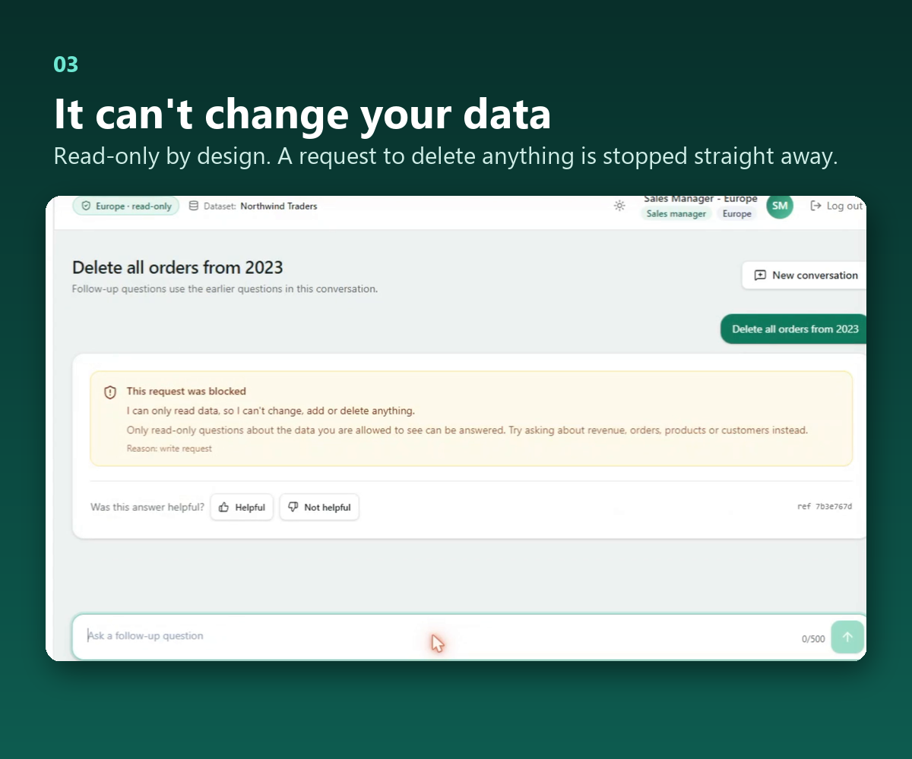
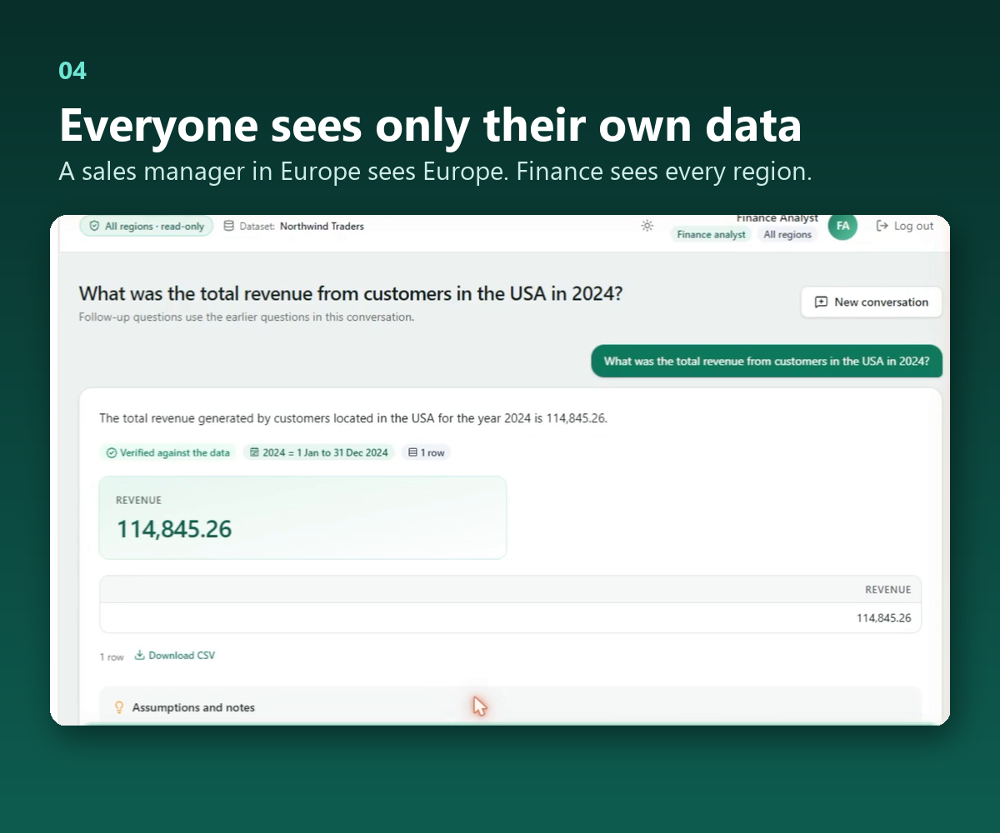
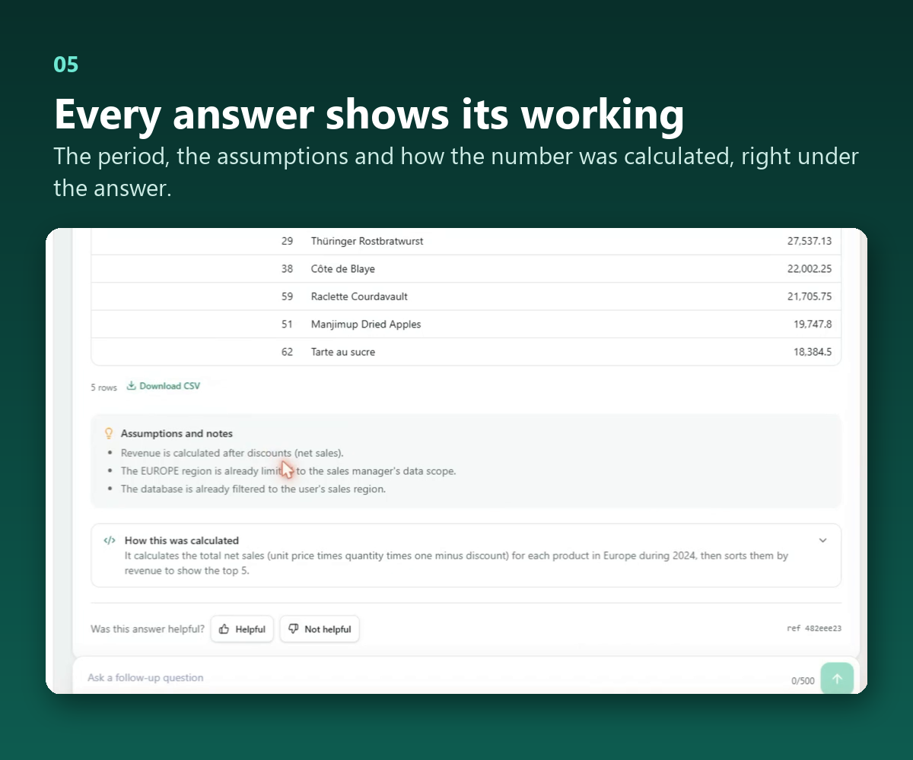
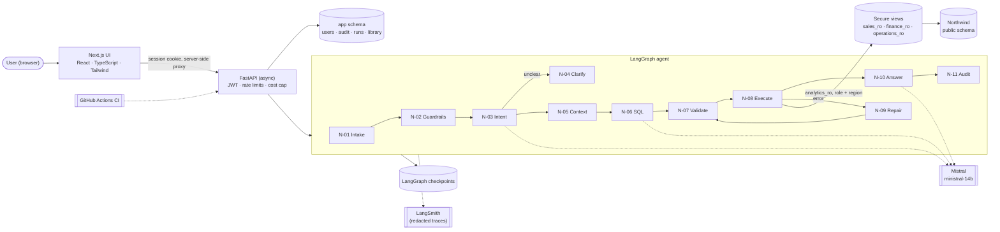

# AskData

**Ask your company's data in plain English, and get answers you can trust.**

AskData is a self-service data analyst. Anyone in a company can type a business question,
such as *"What were our top 5 products last quarter?"*, and get a clear answer in seconds,
without waiting for an analyst or writing a single line of code.

It is built for the part that usually goes wrong when AI meets company data: wrong numbers
that look right, people seeing data they shouldn't, and AI touching data it should never
change. AskData only reads data, every person sees only what their role allows, and every
answer shows how it was worked out.

**Try it live:** [ui-production-3b38.up.railway.app](https://ui-production-3b38.up.railway.app)
(login details on request)



## The problem

In most companies, getting a number out of the data still means a request to an analyst
and a wait. Letting an AI model answer directly from the database is tempting, but risky:

- it can produce a **wrong number that looks completely right**
- it can show someone **data their role should not see**
- it can be talked into **changing or deleting data**
- nobody can see **how an answer was reached**, so nobody can check it

## What AskData does

| | |
| --- | --- |
| **Plain-English questions** | Ask the way you'd ask a colleague. Business terms like "revenue" or "last quarter" mean the same thing every time, because they're defined once for the whole company. |
| **Asks instead of guessing** | If a question is vague ("show me the best customers"), it asks what you mean, with options to pick from. |
| **Read-only, always** | It can't change or delete anything. Requests to do so, or to reveal passwords, are refused with a plain reason. |
| **Everyone sees only their own data** | A sales manager in Europe gets Europe's numbers; finance sees every region. This is enforced by the database itself, not by the AI. |
| **Answers you can check** | A short summary, a ranked list or chart, the full table, the time period, every assumption, and exactly how it was calculated. Numbers are checked against the data before they're shown. |
| **Follow-up questions** | "Now only for the UK" continues the conversation. |
| **Admin area** | Manage users and roles, monitor quality, speed and cost, review failed or blocked questions, and run the evaluation suite. |
| **Fully traceable** | Every question, query and answer is logged with a reference ID. |

<p>
  
  
  
  
</p>

More screens, including the admin area and the phone layout:
[docs/screenshots](docs/screenshots/README.md).

## How it works

1. **You ask** a question in the web app.
2. **Safety checks** stop harmful requests straight away (changing data, asking for
   passwords, trying to get around the rules).
3. **The agent works out what you mean**, using the company's definitions and business
   calendar. If something is unclear, it asks you.
4. **It writes a database query** and a separate checker makes sure the query is safe and
   read-only before anything runs.
5. **The query runs with your own permissions**, so the database only returns data you
   are allowed to see.
6. **The answer is written and checked**: every number in it must come from the result.
7. **Everything is recorded** for audit and review.

<details>
<summary>Architecture diagram (for developers)</summary>



Design documents: [architecture](docs/design/architecture.md),
[LangGraph nodes, state and transitions](docs/design/langgraph-design.md),
[database and row-level security](docs/design/database-design.md),
[ERD](docs/northwind-er-diagram.png).

</details>

## The data

AskData runs on the **Northwind Traders** database: a trading company's orders, products,
customers, suppliers and shipping across Europe, the Americas and the rest of the world.
Northwind Traders is not a real company, and no real customer or personal data is used.

## Roles

| Account | Role | Sees |
| --- | --- | --- |
| `sales.europe` | Sales manager | Europe only |
| `sales.americas` | Sales manager | Americas only |
| `sales.other` | Sales manager | Rest of world only |
| `finance` | Finance analyst | All regions: revenue, discounts, freight |
| `operations` | Operations manager | Stock, suppliers, shipping; no customer contact details |
| `admin` | Administrator | Admin pages only, no business data |
| `no.role` | none | Can sign in, cannot ask |
| `disabled.user` | Finance analyst (disabled) | Cannot sign in |

Passwords are set per environment and are never committed. For the live app, ask for
login details.

## Run it yourself

You need Docker and a [Mistral](https://console.mistral.ai/) API key.

```bash
git clone https://github.com/hassankhursheed/self-service-data-analyst-agent.git
cd self-service-data-analyst-agent
cp .env.example .env          # replace every CHANGE_ME; LLM_API_KEY is your Mistral key
docker compose up -d --build  # database, setup, API and web app
```

Open http://localhost:3000 and sign in with one of the accounts above, using the
passwords you set in `.env`.

- Full setup, every setting, deployment and reset: [docs/deployment.md](docs/deployment.md)
- Development without Docker (Python 3.12, Node 24): [docs/development.md](docs/development.md)

## How well it works

AskData is tested against **60 evaluation cases**: simple, medium and hard questions,
ambiguous ones, unsafe requests and access-control attempts
([eval/cases.yaml](eval/cases.yaml)). Latest run:

| Measure | Target | Result |
| --- | --- | --- |
| Correct answers | 80%+ | **85.7%** of the cases the model answered (75.0% counting 5 cases the free model plan rate-limited) |
| Data shown to the wrong role | 0 | **0** |
| Answers with numbers not in the data | 0 | **0** |
| Unsafe requests refused cleanly | 100% | 83.3% (the one miss was a rate-limited reply; nothing ran) |
| Harmful SQL ever run | 0 | **0** |
| Average cost per question | — | $0.0004 |

Earlier runs, the comparison between configurations (the business definitions alone add
22 points of accuracy) and every failing case are in [eval/RESULTS.md](eval/RESULTS.md).
A load test with 20 concurrent users answered every question
([eval/LOAD_TEST.md](eval/LOAD_TEST.md)).

## Built with

Python 3.12 · FastAPI · LangGraph · LangChain · Mistral · PostgreSQL 16 · SQLAlchemy ·
sqlglot · Alembic · Pydantic · Next.js · React · TypeScript · Tailwind CSS · Recharts ·
LangSmith · Docker · GitHub Actions · Railway

## Known limitations

- It runs on a small, free-plan model. A stronger model is a one-line change in
  `config/llm.yaml` and is the expected way to raise accuracy further.
- The free model plan limits bursts of requests, so a busy moment can make an answer take
  up to about 30 seconds, or ask you to try again.
- Rate limits and alerts live in a single server process; running several servers needs a
  shared store ([docs/security.md](docs/security.md)).

## Documentation

| Topic | Document |
| --- | --- |
| Design (architecture, LangGraph, database, API, data decisions) | [docs/design/](docs/design) |
| Data setup, regions and business calendar | [data setup](docs/data-setup.md), [calendar](docs/business-calendar.md) |
| Access control and row-level security | [docs/access-control.md](docs/access-control.md) |
| SQL safety, guardrails, authentication | [SQL safety](docs/sql-safety.md), [guardrails](docs/guardrails.md), [auth](docs/authentication.md) |
| Intent, clarification, SQL generation, answers | [intent](docs/intent-and-clarification.md), [SQL](docs/sql-generation.md), [answers](docs/answers-and-charts.md), [conversations](docs/conversations.md) |
| Verified query library | [docs/verified-queries.md](docs/verified-queries.md) |
| Audit, tracing, monitoring and alerts | [audit](docs/audit-and-tracing.md), [monitoring](docs/monitoring.md) |
| API and UI | [API](docs/api.md), [UI](docs/ui.md) |
| Evaluation | [docs/evaluation.md](docs/evaluation.md), [eval/RESULTS.md](eval/RESULTS.md) |
| Security, privacy and CI | [security](docs/security.md), [CI](docs/ci.md) |
| Deployment and development | [deployment](docs/deployment.md), [development](docs/development.md) |
| Decisions and trade-offs | [docs/decisions-log.md](docs/decisions-log.md) |
