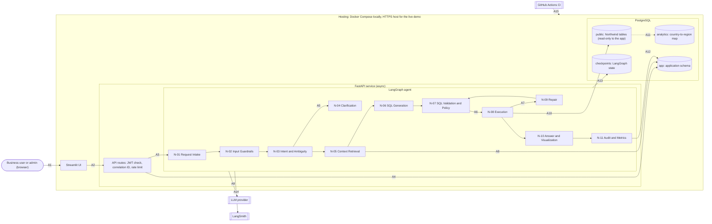

# Architecture

Brief sections 4, 5 and 27. One FastAPI service hosts a LangGraph graph of small nodes; one
PostgreSQL database holds the Northwind data and the application data in separate schemas.

## Diagram

## Arrows

| Arrow | Meaning |
| --- | --- |
| A1 | The user logs in and asks questions in the Streamlit UI over HTTPS. |
| A2 | The UI calls the REST API with a bearer JWT; every response returns the correlation ID. |
| A3 | Ask and clarify requests start a graph run; role and region come from the token and the database, never from the question. |
| A4 | Login, users, conversations, feedback and admin screens read and write the `app` schema with the `app_rw` role. |
| A5 | An ambiguous question stops at N-04, which returns one clarifying question and waits for the user. |
| A6 | Only SQL that passed parsing, allow-lists and limits reaches execution; blocked SQL stops with a reason. |
| A7 | A database error goes to N-09, which repairs the SQL (max 2 attempts) and sends it back through validation. |
| A8 | N-05 reads the semantic catalog, metric definitions, business calendar and verified examples. |
| A9 | N-02, N-03, N-06, N-09 and N-10 call the LLM with schema, definitions and only the result rows needed; no sensitive personal data. |
| A10 | N-08 runs SQL with the read-only login, `SET LOCAL ROLE` and `SET LOCAL app.region` from the token, a statement timeout and a row limit. |
| A11 | Row-level security policies on Northwind tables look up the user's region in the country-to-region map. |
| A12 | N-11 writes the audit trail, per-node steps, latency, tokens, cost and the final status. |
| A13 | The PostgreSQL checkpointer stores conversation state per user and session, so follow-ups work. |
| A14 | Every run is traced in LangSmith; the trace is linked to the question by correlation ID. |
| A15 | CI runs unit tests, integration tests and an evaluation subset on every push, and blocks a release if any check fails. |

## Responsibilities and trust boundaries

- **UI** shows results only; it holds no business logic and no database credentials.
- **API routes** authenticate, assign the correlation ID, apply rate limits and map
  graph results to response models.
- **Graph nodes** each do one job (see `langgraph-design.md`) and are tested on their own.
- **Safety is enforced twice:** in code (N-07 validation) and in the database (read-only
  login, row-level security, column grants). The prompt is never the only control.
- **Two database logins:** `app_rw` for application data and `agent_login` (read-only)
  for Northwind queries. The agent process never holds write credentials for Northwind.
- **Secrets** come from environment variables only (see `.env.example`).
