# Database design

Brief sections 6, 12, 13, 21 and 27. One PostgreSQL database, four schemas:

| Schema | Contents | Written by |
| --- | --- | --- |
| `public` | Northwind tables (loaded from the dump, dates shifted) | seed script only |
| `analytics` | `sales_regions`, `country_region` mapping | seed script only |
| `app` | application tables below (Alembic migrations) | the application (`app_rw`) |
| `checkpoints` | LangGraph checkpointer tables (managed by the library) | the application |

## Application ERD (`app` schema)

Region codes in `app.user_regions` are a CHECK constraint (not a foreign key), so Alembic never depends on a schema outside `app`.

Conventions: UUID primary keys for user-facing rows, `bigint` identity keys for high-volume
logs; every table has `created_at timestamptz` (and `updated_at` where rows change).
Status and type columns are `text` with CHECK constraints. Small lists use `text[]`; there
is no catch-all JSON blob (JSONB is used only for masked input/output summaries).

```mermaid
erDiagram
    questions |o--o{ agent_errors : "question_id"
    agent_runs |o--o{ agent_errors : "run_id"
    questions ||--o{ agent_runs : "question_id"
    agent_runs ||--o{ agent_steps : "run_id"
    users |o--o{ audit_log : "actor_user_id"
    generated_queries |o--o{ blocked_queries : "generated_query_id"
    agent_runs ||--o{ blocked_queries : "run_id"
    questions ||--o{ clarifications : "question_id"
    users ||--o{ conversations : "user_id"
    eval_datasets ||--o{ eval_cases : "dataset_id"
    feedback |o--o{ eval_cases : "source_feedback_id"
    eval_cases ||--o{ eval_results : "case_id"
    questions |o--o{ eval_results : "question_id"
    eval_runs ||--o{ eval_results : "run_id"
    eval_datasets ||--o{ eval_runs : "dataset_id"
    users |o--o{ eval_runs : "started_by"
    questions ||--o{ feedback : "question_id"
    agent_runs |o--o{ feedback : "run_id"
    users ||--o{ feedback : "user_id"
    agent_runs ||--o{ generated_queries : "run_id"
    users |o--o{ metric_definitions : "updated_by"
    generated_queries ||--o{ query_executions : "generated_query_id"
    conversations ||--o{ questions : "conversation_id"
    questions |o--o{ questions : "parent_question_id"
    users ||--o{ questions : "user_id"
    users |o--o{ user_regions : "assigned_by"
    users ||--o{ user_regions : "user_id"
    users |o--o{ user_roles : "assigned_by"
    roles ||--o{ user_roles : "role_id"
    users ||--o{ user_roles : "user_id"
    questions |o--o{ verified_queries : "source_question_id"
    users |o--o{ verified_queries : "verified_by"
    agent_errors {
        bigint id PK
        uuid correlation_id
        uuid question_id FK
        uuid run_id FK
        varchar node_name
        varchar error_type
        boolean retryable
        text error_message
        jsonb input_snapshot
        varchar status
        timestamptz updated_at
        timestamptz created_at
    }
    agent_runs {
        uuid id PK
        uuid question_id FK
        integer run_number
        uuid correlation_id
        varchar graph_version
        varchar prompt_version
        varchar semantic_version
        varchar model_name
        varchar final_status
        integer total_latency_ms
        integer input_tokens
        integer output_tokens
        numeric estimated_cost_usd
        text langsmith_trace_url
        timestamptz started_at
        timestamptz finished_at
        timestamptz created_at
    }
    agent_steps {
        bigint id PK
        uuid run_id FK
        integer seq
        varchar node_name
        varchar from_status
        varchar to_status
        jsonb input_summary
        jsonb output_summary
        integer latency_ms
        varchar error_code
        timestamptz started_at
        timestamptz created_at
    }
    alerts {
        bigint id PK
        varchar alert_type
        numeric metric_value
        numeric threshold
        text message
        varchar channel
        timestamptz sent_at
        timestamptz created_at
    }
    audit_log {
        bigint id PK
        timestamptz occurred_at
        uuid correlation_id
        uuid actor_user_id FK
        varchar event_type
        varchar target_type
        varchar target_id
        jsonb details
        inet client_ip
        timestamptz created_at
    }
    blocked_queries {
        bigint id PK
        uuid run_id FK
        bigint generated_query_id FK
        varchar stage
        varchar reason_code
        text reason_text
        timestamptz created_at
    }
    business_calendar_config {
        smallint id PK
        integer version UK
        date reference_date
        varchar time_zone
        smallint fiscal_year_start_month
        varchar week_start
        boolean is_active
        timestamptz created_at
    }
    clarifications {
        bigint id PK
        uuid question_id FK
        text asked_text
        text_array options
        text answer_text
        timestamptz answered_at
        timestamptz created_at
    }
    conversations {
        uuid id PK
        uuid user_id FK
        varchar title
        boolean is_archived
        timestamptz updated_at
        timestamptz created_at
    }
    eval_cases {
        bigint id PK
        smallint dataset_id FK
        varchar case_key
        varchar case_type
        varchar test_username
        text question
        varchar expected_behaviour
        text expected_sql
        bigint source_feedback_id FK
        timestamptz updated_at
        timestamptz created_at
    }
    eval_datasets {
        smallint id PK
        varchar name
        integer version
        text file_path
        varchar langsmith_dataset_id
        timestamptz created_at
    }
    eval_results {
        bigint id PK
        uuid run_id FK
        bigint case_id FK
        uuid question_id FK
        boolean passed
        varchar final_status
        text failure_reason
        integer latency_ms
        numeric cost_usd
        timestamptz created_at
    }
    eval_runs {
        uuid id PK
        smallint dataset_id FK
        varchar experiment_name
        varchar model_name
        numeric temperature
        varchar graph_version
        varchar prompt_version
        varchar semantic_version
        boolean verified_examples_enabled
        date reference_date
        varchar status
        numeric execution_accuracy
        numeric clarification_rate
        numeric unsafe_blocked_rate
        integer access_leaks
        integer ungrounded_answers
        integer latency_p50_ms
        integer latency_p95_ms
        numeric avg_cost_usd
        uuid started_by FK
        timestamptz started_at
        timestamptz finished_at
        timestamptz updated_at
        timestamptz created_at
    }
    feedback {
        bigint id PK
        uuid question_id FK
        uuid user_id FK
        uuid run_id FK
        varchar rating
        text comment
        varchar review_status
        timestamptz updated_at
        timestamptz created_at
    }
    generated_queries {
        bigint id PK
        uuid run_id FK
        integer attempt
        varchar kind
        text sql_text
        text_array tables_used
        text_array metrics_used
        varchar confidence
        date date_from
        date date_to
        uuid_array verified_query_ids
        timestamptz created_at
    }
    metric_definitions {
        bigint id PK
        varchar name
        text description
        text definition_sql
        text_array tables
        text join_condition
        text_array synonyms
        text_array allowed_roles
        integer version
        boolean is_active
        uuid updated_by FK
        timestamptz updated_at
        timestamptz created_at
    }
    query_executions {
        bigint id PK
        bigint generated_query_id FK
        varchar db_role
        varchar region_code
        varchar status
        integer row_count
        integer result_bytes
        integer latency_ms
        text error_message
        timestamptz executed_at
        timestamptz created_at
    }
    questions {
        uuid id PK
        uuid correlation_id UK
        uuid conversation_id FK
        uuid user_id FK
        uuid parent_question_id FK
        text question_text
        varchar role_name
        varchar region_code
        varchar status
        date resolved_date_from
        date resolved_date_to
        text_array assumptions
        timestamptz completed_at
        timestamptz updated_at
        timestamptz created_at
    }
    roles {
        smallint id PK
        varchar name UK
        varchar db_role
        text description
        timestamptz created_at
    }
    semantic_catalog {
        bigint id PK
        varchar object_type
        varchar object_name
        text description
        text_array example_values
        text_array allowed_roles
        integer version
        boolean is_active
        timestamptz updated_at
        timestamptz created_at
    }
    user_regions {
        uuid user_id PK, FK
        varchar region_code PK
        uuid assigned_by FK
        timestamptz created_at
    }
    user_roles {
        uuid user_id PK, FK
        smallint role_id FK
        uuid assigned_by FK
        timestamptz created_at
    }
    users {
        uuid id PK
        varchar username UK
        text password_hash
        varchar display_name
        boolean is_active
        integer token_version
        timestamptz last_login_at
        timestamptz updated_at
        timestamptz created_at
    }
    verified_queries {
        uuid id PK
        uuid lineage_id
        integer version
        text question_text
        text sql_text
        text description
        text_array tables_used
        text_array metrics_used
        text_array allowed_roles
        uuid source_question_id FK
        boolean is_active
        uuid verified_by FK
        timestamptz verified_at
        timestamptz updated_at
        timestamptz created_at
    }
```

<!-- erd:start -->

<!-- erd:end -->

The ERD above is generated from the SQLAlchemy models (`python scripts/generate_erd.py`), and a unit test fails if it drifts. Relationship labels are the foreign-key columns; `||` means required, `|o` optional. `text_array` and `uuid_array` stand for `text[]` and `uuid[]` (Mermaid cannot show brackets). Status and type columns are limited by CHECK constraints backed by `app/core/enums.py`.

### Unique constraints and indexes

| Table | Unique constraints | Indexes (besides PK/FK) |
| --- | --- | --- |
| users | `username` | |
| roles | `name` | |
| user_roles | `user_id` (one role per user) | `role_id` |
| user_regions | PK `(user_id, region_code)`; CHECK `region_code` in `EUROPE`, `AMERICAS`, `ROW` | |
| conversations | | `(user_id, updated_at DESC)` |
| questions | `correlation_id` | `(conversation_id, created_at)`, `(status, created_at)`, `(user_id, created_at)`, `(created_at)` |
| agent_runs | `(question_id, run_number)` | `(correlation_id)`, `(started_at)`, `(final_status, started_at)` |
| agent_steps | `(run_id, seq)` | `(node_name, started_at)` |
| generated_queries | `(run_id, attempt)` | `(kind, run_id)` |
| query_executions | | `(generated_query_id)`, `(status, executed_at)` |
| blocked_queries | | `(run_id)`, `(reason_code, created_at)`, `(created_at)` |
| clarifications | | `(question_id)`, `(created_at)` |
| feedback | `(question_id, user_id)` | `(rating, review_status)`, `(updated_at)` |
| semantic_catalog | `(object_type, object_name, version)`; partial unique `(object_type, object_name) WHERE is_active` | |
| metric_definitions | `(name, version)`; partial unique `(name) WHERE is_active` | |
| business_calendar_config | `version`; partial unique `(is_active) WHERE is_active` | |
| verified_queries | `(lineage_id, version)`; partial unique `(lineage_id) WHERE is_active` | `(is_active)` |
| eval_datasets | `(name, version)` | |
| eval_cases | `(dataset_id, case_key)` | `(case_type)` |
| eval_runs | | `(started_at)`, `(status)` |
| eval_results | `(run_id, case_id)` | `(passed)` |
| audit_log | | `(occurred_at)`, `(event_type, occurred_at)`, `(correlation_id)`, `(actor_user_id)` |
| agent_errors | | `(status, created_at)`, `(correlation_id)` |
| alerts | | `(alert_type, created_at)` |

## Access plan

Implemented in Step 6; the full description is in `docs/access-control.md`. Summary:

| Role | Login | Rights |
| --- | --- | --- |
| owner (`POSTGRES_USER`) | yes | Runs migrations and the seed. Never used by the running app. |
| `app_rw` | yes | `SELECT, INSERT, UPDATE, DELETE` on the `app` schema only. |
| `analytics_ro` | yes | Read-only login for N-08: `SELECT` on the secure-view schemas `sales_ro`, `finance_ro`, `operations_ro` only. No rights on `public`, `analytics` or `app`; no `CREATE` or `TEMP`; `set_config` not executable. |

- Each business role has one schema of `security_barrier` views over the Northwind tables
  that contain only the columns the role may see (`config/access_policy.yaml`).
- Each query runs in a `READ ONLY` transaction with `SET LOCAL search_path` (the role's
  view schema), `SET LOCAL app.user_role`, `SET LOCAL app.user_region` (sales only) and
  `SET LOCAL statement_timeout`, all from the token-derived `UserContext`.
- The views check `app.user_role` and, for `sales_ro`, keep only rows whose customer or
  order belongs to `app.user_region`. Missing settings return no rows (fail closed).
- `app.roles.db_role` stores the role's view schema name.

The Step 2 plan (group roles switched with `SET LOCAL ROLE`, RLS policies and column
grants on the base tables) was replaced by this design in Step 6; see
`docs/decisions-log.md`.
