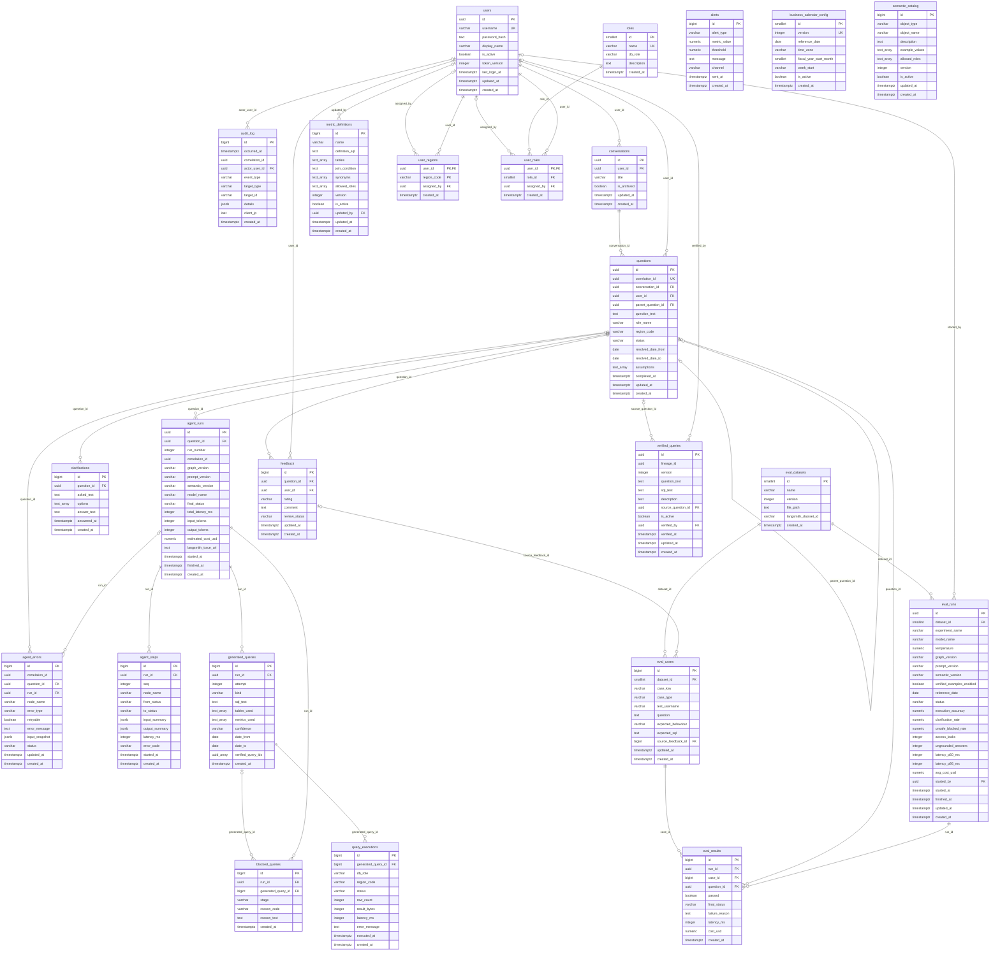

# Database design

Brief sections 6, 12, 13, 21 and 27. One PostgreSQL database, four schemas:

| Schema | Contents | Written by |
| --- | --- | --- |
| `public` | Northwind tables (loaded from the dump, dates shifted) | seed script only |
| `analytics` | `sales_regions`, `country_region` mapping | seed script only |
| `app` | application tables below (Alembic migrations) | the application (`app_rw`) |
| `checkpoints` | LangGraph checkpointer tables (managed by the library) | the application |

## Application ERD (`app` schema)

Region codes in `app.user_regions` are a CHECK constraint (not a foreign key), so Alembic never depends on a schema outside `app`.

Conventions: UUID primary keys for user-facing rows, `bigint` identity keys for high-volume
logs; every table has `created_at timestamptz` (and `updated_at` where rows change).
Status and type columns are `text` with CHECK constraints. Small lists use `text[]`; there
is no catch-all JSON blob (JSONB is used only for masked input/output summaries).

<!-- erd:start -->

<!-- erd:end -->

The ERD above is generated from the SQLAlchemy models (`python scripts/generate_erd.py`), and a unit test fails if it drifts. Relationship labels are the foreign-key columns; `||` means required, `|o` optional. `text_array` and `uuid_array` stand for `text[]` and `uuid[]` (Mermaid cannot show brackets). Status and type columns are limited by CHECK constraints backed by `app/core/enums.py`.

### Unique constraints and indexes

| Table | Unique constraints | Indexes (besides PK/FK) |
| --- | --- | --- |
| users | `username` | |
| roles | `name` | |
| user_roles | `user_id` (one role per user) | `role_id` |
| user_regions | PK `(user_id, region_code)`; CHECK `region_code` in `EUROPE`, `AMERICAS`, `ROW` | |
| conversations | | `(user_id, updated_at DESC)` |
| questions | `correlation_id` | `(conversation_id, created_at)`, `(status, created_at)`, `(user_id, created_at)` |
| agent_runs | `(question_id, run_number)` | `(correlation_id)`, `(started_at)`, `(final_status, started_at)` |
| agent_steps | `(run_id, seq)` | `(node_name, started_at)` |
| generated_queries | `(run_id, attempt)` | |
| query_executions | | `(generated_query_id)`, `(status, executed_at)` |
| blocked_queries | | `(run_id)`, `(reason_code, created_at)` |
| clarifications | | `(question_id)` |
| feedback | `(question_id, user_id)` | `(rating, review_status)` |
| semantic_catalog | `(object_type, object_name, version)`; partial unique `(object_type, object_name) WHERE is_active` | |
| metric_definitions | `(name, version)`; partial unique `(name) WHERE is_active` | |
| business_calendar_config | `version`; partial unique `(is_active) WHERE is_active` | |
| verified_queries | `(lineage_id, version)`; partial unique `(lineage_id) WHERE is_active` | `(is_active)` |
| eval_datasets | `(name, version)` | |
| eval_cases | `(dataset_id, case_key)` | `(case_type)` |
| eval_runs | | `(started_at)`, `(status)` |
| eval_results | `(run_id, case_id)` | `(passed)` |
| audit_log | | `(occurred_at)`, `(event_type, occurred_at)`, `(correlation_id)`, `(actor_user_id)` |
| agent_errors | | `(status, created_at)`, `(correlation_id)` |
| alerts | | `(alert_type, created_at)` |

## Access plan

### Database roles

| Role | Login | Purpose and rights |
| --- | --- | --- |
| `owner` | yes | Owns all schemas; runs the seed script and Alembic migrations. Never used by the running app. |
| `app_rw` | yes | Used by the API for application data: SELECT, INSERT, UPDATE, DELETE on `app` and `checkpoints` only. No rights on `public` or `analytics`. |
| `agent_login` | yes | Read-only login used by N-08. No direct table rights; it is a member of the three group roles below and can only switch to them. Default `default_transaction_read_only = on`. |
| `sales_ro` | no | SELECT on allowed Northwind columns; rows filtered by region (RLS). |
| `finance_ro` | no | SELECT on all order and financial data; no employee personal data. |
| `operations_ro` | no | SELECT on products, suppliers, shipping; no customer contact details. |

No role has INSERT, UPDATE, DELETE, TRUNCATE, CREATE or function-creation rights on
`public` or `analytics`. `CONNECT` is revoked from `PUBLIC`, and `CREATE` on schema
`public` is revoked from everyone except `owner`.

### How role and region reach the session

N-08 runs every query in its own transaction:

```sql
BEGIN READ ONLY;
SET LOCAL ROLE sales_ro;                 -- from the token's role, mapped in app.roles.db_role
SET LOCAL app.region = 'EUROPE';         -- from the token, verified against app.user_regions
SET LOCAL statement_timeout = '10s';     -- from config
<validated SELECT with LIMIT>;
COMMIT;
```

- Both values are bound as parameters (`set_config('app.region', $1, true)`), never built
  from the question text.
- `SET LOCAL` lasts only for the transaction, so a pooled connection never keeps another
  user's role or region.
- Admins and users with no role never reach N-08 (rejected in N-01).

### Row-level security policies

RLS is enabled (and `FORCE`d) on `customers`, `orders` and `order_details`. Other Northwind
tables contain no regional data and are controlled by grants only.

| Table | Role | Policy (`USING`) |
| --- | --- | --- |
| `customers` | `sales_ro` | `country IN (SELECT country FROM analytics.country_region WHERE region_code = current_setting('app.region', true))` |
| `orders` | `sales_ro` | `customer_id IN (SELECT customer_id FROM customers)` (inherits the customers policy) |
| `order_details` | `sales_ro` | `order_id IN (SELECT order_id FROM orders)` (inherits the orders policy) |
| all three | `finance_ro`, `operations_ro` | `true` |

If `app.region` is unset, `current_setting(..., true)` returns NULL and the policy matches no
rows (fail closed). Policies are `SELECT`-only; there are no write policies.

### Sensitive columns by role

Enforced with column-level `GRANT SELECT (col, ...)`. A query that names a hidden column
fails in N-07 (allow-list) and would also fail in the database.

| Table: sensitive columns | `sales_ro` | `finance_ro` | `operations_ro` |
| --- | --- | --- | --- |
| `employees`: address, city, region, postal_code, country, home_phone, extension, birth_date, notes, photo, photo_path | hidden | hidden | hidden |
| `employees`: employee_id, first_name, last_name, title, title_of_courtesy, hire_date, reports_to | visible | visible | visible |
| `customers`: contact_name, contact_title, phone, fax, address, postal_code | visible (own region only) | hidden | hidden |
| `customers`: customer_id, company_name, city, region, country | visible (own region only) | visible | visible |
| `suppliers`: contact_name, contact_title, phone, fax, address, homepage | hidden | hidden | visible |
| `orders`, `order_details` | visible (own region only) | visible | visible |
| `products`, `categories` (except `picture`), `shippers` | visible | visible | visible |
| `territories`, `employee_territories`, `region`, `us_states` | hidden | hidden | hidden |

`categories.picture` and `employees.photo` are binary and never exposed. The
`customer_customer_demo` and `customer_demographics` tables are empty and not granted.
