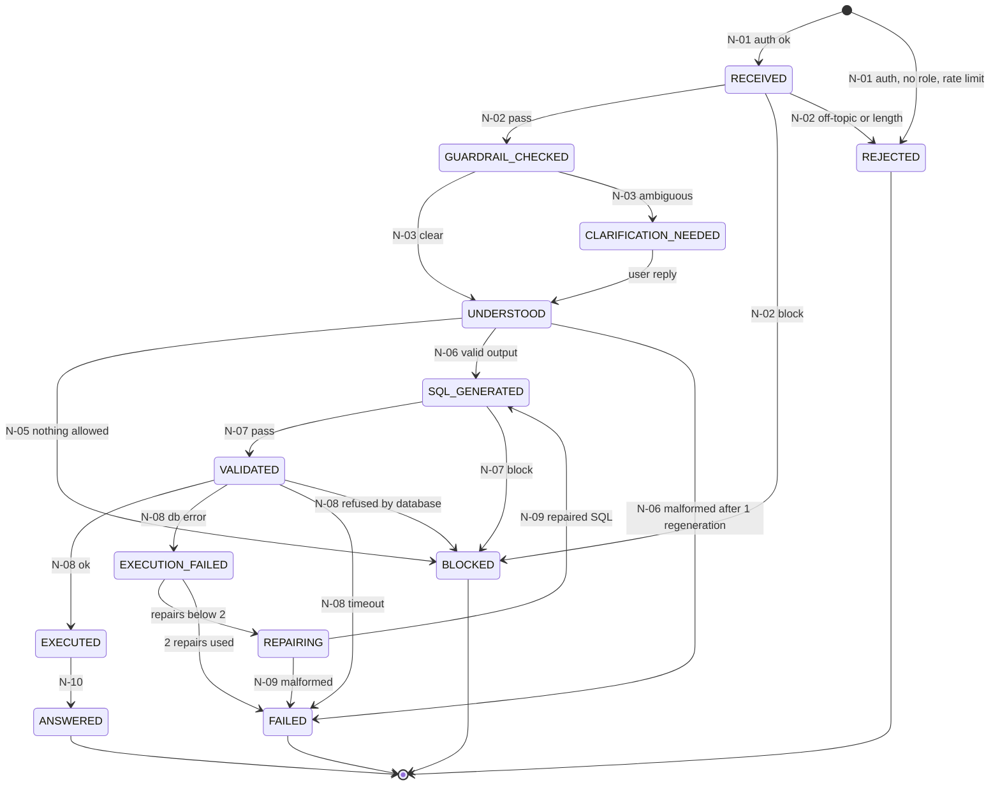

# LangGraph design

Brief sections 4, 11, 14, 15, 17, 18 and 22. The agent is a LangGraph `StateGraph` of
eleven nodes. Each node does one job, reads only the state fields it needs and writes only
its own outputs. Every node appends a step record (`steps`) so any run can be replayed from
the audit trail.

## State schema

The state is a Pydantic model (`AgentState`). Nested types are Pydantic models too.

| Field | Type | Purpose |
| --- | --- | --- |
| `correlation_id` | `UUID` | Ties the request, audit rows, errors and the LangSmith trace together. |
| `conversation_id` | `UUID` | Conversation (and checkpointer thread) the question belongs to. |
| `question_id` | `UUID` | Row in `app.questions` for this question. |
| `user_id` | `UUID` | Authenticated user, from the token. |
| `role` | `RoleName \| None` | `sales_manager`, `finance_analyst`, `operations_manager`, `admin`; from the token and database only. |
| `region` | `RegionCode \| None` | `EUROPE`, `AMERICAS` or `ROW` for sales managers, else `None`. |
| `question` | `str` | The user's question, length-checked. |
| `history` | `list[ConversationTurn]` | Earlier questions, resolved intents and SQL in this conversation, for follow-ups. |
| `status` | `QuestionStatus` | Current state from the transition table below. |
| `guardrail_result` | `GuardrailResult \| None` | Pass or block, with the reason code (length, injection, off-topic, PII). |
| `intent` | `Intent \| None` | Metric, entities, grouping, filters, top N and time expression. |
| `clarification` | `Clarification \| None` | Question asked, options offered and the user's reply. |
| `assumptions` | `list[str]` | Minor assumptions stated in the answer, e.g. "Assumed calendar year 2025". |
| `date_range` | `DateRange \| None` | Resolved `from`/`to` dates and the label, using the business reference date. |
| `context` | `RetrievedContext \| None` | Tables, columns, join paths and metric definitions allowed for the role. |
| `verified_examples` | `list[VerifiedExample]` | Similar verified queries used as few-shot examples (ids and versions). |
| `generated` | `GeneratedSQL \| None` | Structured LLM output: `sql`, `tables_used`, `metrics_used`, `date_range`, `assumptions`, `confidence`. |
| `regeneration_attempts` | `int` | Regenerations after malformed output; **maximum 1**. |
| `validation` | `ValidationResult \| None` | Pass or block; final SQL after LIMIT is added; block reason. |
| `execution` | `ExecutionResult \| None` | Columns, rows (capped), row count, latency, or the database error. |
| `repair_attempts` | `int` | Repairs after database errors; **maximum 2**. |
| `answer` | `Answer \| None` | Explanation, chart spec, SQL description, confidence label, grounding check result. |
| `error` | `AgentError \| None` | Unrecoverable error with node, type and whether it was retryable. |
| `usage` | `Usage` | Input/output tokens and estimated cost so far; checked against the per-question budget. |
| `steps` | `list[StepRecord]` | Per node: name, from/to status, input/output summary, latency. |
| `graph_version` | `str` | Graph version recorded with every run. |
| `prompt_version` | `str` | Prompt config version recorded with every run. |

## Nodes

| Node | Input fields | Output fields | Success status | Failure path |
| --- | --- | --- | --- | --- |
| N-01 Request Intake | token claims, `question`, `conversation_id` | `user_id`, `role`, `region`, `correlation_id`, `history` | `RECEIVED` | Invalid token, disabled user, no role or rate limit: `REJECTED` |
| N-02 Input Guardrails | `question`, `role` | `guardrail_result` | `GUARDRAIL_CHECKED` (scope-override attempts are flagged and continue) | Injection, data change, personal data: `BLOCKED`; empty, too long, off-topic: `REJECTED` (docs/guardrails.md) |
| N-03 Intent and Ambiguity | `question`, `history`, calendar config | `intent`, `date_range`, `assumptions` | `UNDERSTOOD` | Missing time range, metric, entity, grouping or top N: `CLARIFICATION_NEEDED` |
| N-04 Clarification | `pending_clarification` | `clarifications` (question, options, reply) | pauses with a LangGraph interrupt | The reply goes back to N-03, then `UNDERSTOOD`; still unclear after 2 rounds: `FAILED` |
| N-05 Context Retrieval | `intent`, `role` | `context`, `verified_examples` | stays `UNDERSTOOD` | Nothing allowed for the role: `BLOCKED` |
| N-06 SQL Generation | `question`, `intent`, `context`, `verified_examples`, `date_range` | `generated` | `SQL_GENERATED` | Malformed output: regenerate once; still malformed: `FAILED` |
| N-07 SQL Validation and Policy | `generated.sql`, `role` | `validation` | `VALIDATED` | Not a single SELECT, DML/DDL, system catalog, disallowed table or column: `BLOCKED` |
| N-08 Execution | `validation.sql`, `role`, `region` | `execution` | `EXECUTED` | Database error: `EXECUTION_FAILED`; timeout: `FAILED` with a timeout message |
| N-09 Repair | `validation.sql`, `execution.error`, `context` | new `generated`, `repair_attempts + 1` | `REPAIRING`, then `SQL_GENERATED` | `repair_attempts` already 2: `FAILED` |
| N-10 Answer and Visualization | `execution`, `date_range`, `assumptions`, `generated` | `answer` | `ANSWERED` | Numbers in the text not found in the result: rewrite without them and mark low confidence |
| N-11 Audit and Metrics | the whole state | rows in `agent_runs`, `agent_steps`, `audit_log`, `agent_errors` | keeps the final status | Audit write failure is logged; never changes the user's answer |

N-11 runs at the end of every path, including `REJECTED`, `BLOCKED` and `FAILED`.

## Allowed transitions

Any transition not in this table is rejected by the graph router and ends as `FAILED`.

| From | Condition | To | Node |
| --- | --- | --- | --- |
| (start) | Token valid, user active, role assigned, under rate limit | `RECEIVED` | N-01 |
| (start) | Disabled user, no role, admin, sales manager without region (rate limit later) | `REJECTED` | N-01 |
| `RECEIVED` | Input passes all guardrails | `GUARDRAIL_CHECKED` | N-02 |
| `RECEIVED` | Injection, data-change or personal-data request | `BLOCKED` | N-02 |
| `RECEIVED` | Empty, too long or off-topic | `REJECTED` | N-02 |
| `GUARDRAIL_CHECKED` | Intent is clear (minor assumptions allowed) | `UNDERSTOOD` | N-03 |
| `GUARDRAIL_CHECKED` | Answer would change depending on a missing part | `CLARIFICATION_NEEDED` | N-03 |
| `CLARIFICATION_NEEDED` | User replies (via `POST /clarify`) | `UNDERSTOOD` | N-04, N-03 |
| `UNDERSTOOD` | No allowed context for the role | `BLOCKED` | N-05 |
| `UNDERSTOOD` | Valid structured SQL produced (after at most 1 regeneration) | `SQL_GENERATED` | N-06 |
| `UNDERSTOOD` | Output still malformed after 1 regeneration | `FAILED` | N-06 |
| `SQL_GENERATED` | SQL passes validation and policy | `VALIDATED` | N-07 |
| `SQL_GENERATED` | SQL violates validation or policy | `BLOCKED` | N-07 |
| `VALIDATED` | Query succeeds | `EXECUTED` | N-08 |
| `VALIDATED` | Database error (not a timeout) | `EXECUTION_FAILED` | N-08 |
| `VALIDATED` | Statement timeout | `FAILED` | N-08 |
| `VALIDATED` | The database refused the query (permissions) | `BLOCKED` | N-08 |
| `EXECUTION_FAILED` | `repair_attempts < 2` | `REPAIRING` | N-09 |
| `EXECUTION_FAILED` | `repair_attempts = 2` | `FAILED` | N-09 |
| `REPAIRING` | Repaired SQL produced | `SQL_GENERATED` | N-09 |
| `REPAIRING` | Repair output malformed | `FAILED` | N-09 |
| `EXECUTED` | Answer built (empty results are answered honestly) | `ANSWERED` | N-10 |
| any non-final | Unrecoverable LLM or database error after retries, or budget exceeded | `FAILED` | any |

Final states: `ANSWERED`, `BLOCKED`, `REJECTED`, `FAILED`. `CLARIFICATION_NEEDED` pauses
the run until the user replies.

## Limits

| Limit | Value | Where enforced |
| --- | --- | --- |
| Regenerations after malformed structured output | 1 | N-06 (`regeneration_attempts`) |
| SQL repairs after database errors | 2 | N-09 (`repair_attempts`); the third failure ends as `FAILED` |
| LLM retries on retryable errors | 3, with backoff | LLM client wrapper used by every LLM node |
| Token or cost budget per question | from config | checked before each LLM call; exceeded: `FAILED` |

All limit values live in versioned config, not in code.

## Conversations and follow-ups

- The PostgreSQL checkpointer stores state per thread; the thread id is the conversation
  id, and conversations are scoped to the user.
- A follow-up ("now only for Germany") runs the whole graph again from N-01. `history`
  supplies the earlier intent and SQL, but guardrails, validation and access rules are
  applied again. Earlier approval never carries over.

## Implementation (Step 11)

- `app/agent/state.py`: `AgentState` (Pydantic) with `AgentRequest` (identity from the
  token, never from the question), typed slots for later nodes, and `steps`, which grows by
  one `StepRecord` per node (start, end, duration, input and output summaries, error code).
- `app/agent/transitions.py`: `ALLOWED` (the table above as data), `check_transition`
  (raises `IllegalTransition`; any running status may go to `FAILED`; final statuses never
  change; intermediate statuses such as `REPAIRING` are passed as `via`) and `ROUTES`,
  the next node for each (node, status). `next_node` is the graph's only router.
- `app/agent/nodes/`: one module per node. `base.agent_node` wraps every node: it checks
  the transition, records the step, and turns unexpected errors into `FAILED` with a safe
  message. N-03 to N-11 are stubs with fixed results until their own steps.
- `app/agent/graph.py`: the `StateGraph`, conditional edges built from `ROUTES` only, and
  the `Agent` class (`run`, `resume`, `state`) with a checkpointer. `config/agent.yaml` holds
  `graph_version` and the intent rules.
- Step 12: N-03 (`nodes/n03_intent.py`) and N-04 (`nodes/n04_clarification.py`); see
  `docs/intent-and-clarification.md`.
- Step 13: N-05 to N-09 (`nodes/n05_context.py` ... `nodes/n09_repair.py`), wired through
  `AgentDeps` (semantic loader, read-only executor, SQL policy, limits); see
  `docs/sql-generation.md`. N-10 and N-11 are still stubs. The checkpoint serializer only
  restores the app's own state types (`app/agent/checkpoint.py`).
- Step 14: N-10 (`nodes/answer.py`) with the grounding check, chart rules and the response
  model; see `docs/answers-and-charts.md`. Only N-11 is still a stub.
- Step 15: PostgreSQL checkpointer and user-scoped conversation threads
  (`app/agent/conversations.py`, `app/agent/memory.py`); `steps` is a plain list so a new
  question in a thread starts clean; `history` and `interpreted_question` support
  follow-ups. See `docs/conversations.md`.
- Step 16: N-11 writes the audit trail (`nodes/n11_audit.py`, `app/agent/audit.py`); the
  state keeps every SQL attempt and execution; the correlation ID is the LangSmith run ID.
  All nodes are now real. See `docs/audit-and-tracing.md`.
